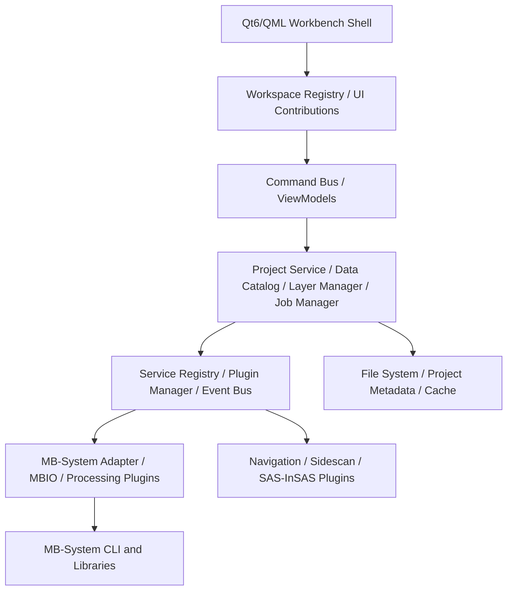

# MB-Studio UI Architecture Redesign and Feature Expansion Plan

> **Document type:** Software architecture design / UI and interaction plan / iterative implementation plan  
> **Applies to:** [Sqhh99/MB-Studio](https://github.com/Sqhh99/MB-Studio)  
> **Planning baseline:** v0.1.0, plus the completed Windows native port and EM122 data-processing validation  
> **Stack:** C++20, Qt 6 / QML, CMake, MB-System, plugin microkernel  
> **Document date:** 2026-10-13  
> **Status:** implemented in large part by MB-Studio 0.2.0; see *Implementation status*.  
> **Nature:** Design proposal. Unless explicitly noted, new interfaces, directories, and features in this document are **planning targets**. They do not mean the repository already implements them.

## Implementation status (MB-Studio 0.2.0)

Version 0.2.0 implements the vertical slice of §8.1 and extends it to the whole
standard MB-System processing chain. Where the implementation differs from the
proposal below, the implementation is described here.

| Proposal | 0.2.0 |
| --- | --- |
| Workspace registry / `IWorkbenchContribution` (§3.3, P1) | `ContributionRegistry` in the kernel (`kernel/Contributions.h`): workspaces, actions bound to commands, panels; validated, all-or-nothing registration, removed with the plugin. The QML shell builds menus and document tabs from it; the built-in views are registered the same way (`QmlFrontend.cpp`). |
| Command bus (§2.4) | Kernel commands plus `ui:` commands for shell actions; menus, toolbar, shortcuts and the command palette (Ctrl+Shift+P) all call `App.trigger()`. |
| JobManager (§4.4) | `IJobService` in the mbsystem plugin: queue, bounded concurrency, structured argument lists, in-process steps, cancel, retry, a log file per job, stage messages (no invented percentages), `job.*` events. |
| ProjectService / DataCatalog / provenance (§4.1–4.3, P2) | `IProjectService` in the new `project` plugin (Qt Core for JSON only): `.mbsproj` project file, survey lines with metadata, assets with type, parent and job, layers, workspace state, history with commands, parameters, inputs, outputs, exit code, times, log and MB-System version. One working folder per job. |
| Declarative parameter schema + tool-specific mapping (§5) | `ProcessingViewModel` schemas (type, unit, range, options, visibility rules) rendered by one generic QML panel; `IProcessingService` maps typed parameters explicitly to the options of `mbpreprocess`, `mbclean`, `mbareaclean`, `mbset`, `mblevitus`, `mbotps`, `mbprocess`, `mbgrid`, `mbbackangle`, `mbmosaic`, `gmt grdconvert/grd2xyz`, `mbgrd2gltf`, `mbswath2las`, `mblist`. Every panel shows the exact commands before running. |
| `mbgrid` panel (§5.3) | Cell size and unit, algorithm and threshold, interpolation distance/mode/tension, quality grids, geographic or UTM, extent; grid size and memory estimate; interpolation warning; unique output names; products registered and shown on the map. |
| EM122 closed loop (§7) | Import of files or folders with format detection and automatic datalists (`$PROCESSED` aware), `.inf/.fbt/.fnv` and metadata in a background job; map of all tracks; grid layers; NoData share, data count, standard deviation and hatched interpolated cells in the grid view; reopen restores lines, products, layer styles, open views and history. |
| Docking shell (§2.3) | Menu bar, processing toolbar, project panel (lines with multi-selection, products with layer visibility), document tabs, properties/processing panel, jobs and log panel, status bar; panel sizes remembered. |
| Not yet | Undo/redo, splittable views, 3D point clouds, navigation editing (`mbnavadjust`), SAS/InSAS, a GUI test that drives mouse input. |

Datalists cannot hold paths with spaces (MBIO reads entries with `%s`), and
`mb_make_info` builds shell commands without quoting. MB-Studio therefore
passes programs paths relative to the job folder, which keeps spaces in the
project folder harmless; data whose relative path contains spaces are
rejected with an explanation.

## 1. Background and problem statement

MB-Studio can already invoke MB-System processing programs. It has completed real Kongsberg EM122 data reads, `mbgrid` grid generation, NetCDF `.grd` loading, and an initial terrain display. That validates the basic chain: **Windows port + command-line processing engine + Qt 6 / QML GUI**.

The core risk in the next stage is not that there are too few command-line tools. It is this: if expansion continues as **add a tool → add a page/form**, the UI and business logic will couple over time, the navigation structure will get out of hand, and job output will be hard to associate with a project. Once multi-line processing, navigation adjustment, sidescan sonar, and SAS/InSAS are added, maintenance cost will rise quickly.

### 1.1 Current problems and the direction of change

| Current state or risk | Long-term effect | Target change |
| --- | --- | --- |
| The main UI uses a fixed page/navigation structure | Adding a feature requires editing the main UI | Dynamic navigation, commands, and workspace registration contributed by plugins |
| Controllers directly own concerns such as page selection | Page state and business state are coupled | `WorkspaceManager` + command routing + a ViewModel layer |
| CLI parameters are entered mainly as strings | Users must remember options such as `-I/-F/-E/-C` | Declarative parameter schemas, task wizards, and command preview |
| The grid view is focused on a single file | Hard to link survey lines, navigation, DEMs, and quality results | Project resource tree, layer management, and a multi-view workspace |
| `.all/.inf/.fbt/.fnv/.grd` are managed by the user | Data origin, cache, and result relationships are unclear | Project-level resource index and processing provenance |
| Features are scattered across independent pages | A complete processing chain requires manual cross-page operation | Import → preprocess → grid → QA → export workflow |
| The boundary between the GUI and background jobs still needs to be strengthened | Large computations freeze the UI, and errors are hard to trace | Async JobManager, logging, and cancellation |
| No globally consistent design rules | Styles and interaction diverge once there are many plugins | A unified design system and a reusable QML control library |

> The table above is an architectural diagnosis and design direction based on prior discussion. Before implementation, re-audit against the source and build results of the current commit.

### 1.2 Design principles

1. **Keep what already works.** Do not throw away the Windows port, MBIO/MB-System, the command-line tools, or the microkernel.
2. **Center the product on the project and the data.** The user should see survey lines, layers, jobs, and products first, not a list of executables.
3. **Decouple the UI from the algorithms.** A graphical page is an optional consumer of an algorithm service. Algorithms must still run with no GUI.
4. **Plugins contribute; they do not edit the host.** A plugin declares capabilities. The host owns navigation, presentation, and lifecycle.
5. **Replace incrementally.** Keep the existing Tools page as an advanced entry, and build specialized workspaces step by step.
6. **Accept against real data.** Use PatchSurveyEM122 for end-to-end integration and cross-platform regression.
7. **Make runs reproducible and traceable.** Record input files, processing parameters, tool versions, timestamps, outputs, and logs.

---

## 2. Product positioning and information architecture

### 2.1 Product positioning

**MB-Studio: a cross-platform, plugin-based marine acoustic data processing and visualization workstation.**

Target users: ocean mapping, sonar data processing, AUV/USV research and development, and research algorithm developers.

The GUI is no longer centered on an executable launcher. It is centered on a saveable, recomputable, visual **Project-Centric Workbench**.

### 2.2 Recommended navigation

| Top-level module | Second-level capabilities | Underlying capability or data |
| --- | --- | --- |
| Workbench | Recent projects, jobs, workflow entry points | Project / Job |
| Data management | Import, format check, survey-line list, metadata | `mbformat`, `mbinfo`, MBIO |
| Multibeam bathymetry | Outlier cleaning, preprocessing, sound-speed correction, gridding | `mbclean`, `mbpreprocess`, `mbprocess`, `mbgrid` |
| Acoustic imagery | Sidescan data, backscatter, intensity mosaics | `mbfilter`, `mbmosaic` |
| Navigation and positioning | Track, attitude, time sync, survey-line alignment | Navigation tools such as `mbnavlist`; extending `mbnavadjust` requires a separate port/integration |
| Visualization | 2D DEM, 3D terrain, point cloud, coverage map, quality map | `.grd`, point clouds, grid statistics |
| Advanced tools | Direct MB-System CLI invocation, parameter help | Existing tool-execution capability |
| Settings and extensions | Plugins, toolchain, performance, workspace layout | PluginManager / Preferences |

**Do not implement each top-level module as a full-screen page that cannot coexist with the others.** A module should contribute menus, commands, editors/views, and dock panels, so the user can work on several files and products at once.

### 2.3 Workbench layout sketch

```text
┌─────────────────────────────────────────────────────────────────────────┐
│ MB-Studio │ File  Edit  View  Process  Tools  Plugins  Help             │
├─────────────────────────────────────────────────────────────────────────┤
│ Project EM122-Survey   [Import] [Save] [Generate Grid] [Run] [Export]   │
├────────────────┬──────────────────────────────────────┬────────────────┤
│ Project        │ Workspace tabs                        │ Properties /   │
│ resources      ├──────────────────────────────────────┤ process params │
│                │ [Line overview] [Terrain] [Nav] [QA]  │ Output grid:   │
│ ▾ Raw lines    │                                      │ 10 m           │
│   0012.all     │           2D/3D main canvas           │ Algorithm: F5  │
│   0013.all     │                                      │ Interp: C3/1   │
│ ▾ Aux cache    │   Terrain + lines + layer overlay    │ Ramp: Haxby    │
│   *.inf        │   + cursor query                     │ Hillshade /    │
│   *.fnv        │                                      │ contours       │
│ ▾ Terrain      │                                      │ Layer vis /    │
│   products     │                                      │ opacity        │
│   raw.grd      │                                      │                │
│   filled.grd   │                                      │                │
├────────────────┴──────────────────────────────────────┴────────────────┤
│ [Job queue] [Process log] [Diagnostics] [Advanced command terminal]    │
├─────────────────────────────────────────────────────────────────────────┤
│ Ready | EPSG:4326 | Cursor X/Y/Z | Valid coverage | CPU/mem | Current  │
└─────────────────────────────────────────────────────────────────────────┘
```

### 2.4 Core interaction conventions

- **Main view:** multi-document tabs (or splittable views), with synchronized location and a shared cursor coordinate.
- **Left resource tree:** raw data, cache, project products, and processing history; drag onto a view.
- **Right property panel:** show only settings for the current selection. Do not pile every parameter onto one page.
- **Bottom job area:** run, progress, logs, errors, cancel, retry, and history.
- **One command system:** menus, shortcuts, the command palette, and plugin entry points all fire the same command service.
- **Persisted layout:** remember workspace tabs, dock sizes, visible layers, and render parameters.

---

## 3. Technical architecture plan

### 3.1 Layering



> "Microkernel" here means a desktop plugin architecture, not an operating-system kernel.

### 3.2 Responsibility boundaries

| Layer | Owns | Must not do |
| --- | --- | --- |
| Kernel | Plugin loading, service registration, events, job scheduling | Contain specific bathymetry logic or QML page logic |
| Workbench Shell | Main window, navigation, dock areas, view lifecycle | Parse `.all` or assemble every tool's parameters |
| Domain Services | Project, resources, layers, processing jobs, provenance | Depend on concrete page objects |
| Processing Adapters | MBIO/CLI/algorithm calls, input/output conversion | Manage windows and UI state |
| UI Plugins | Contribute pages, views, toolbars, property editors | Bypass shared services and mutate another plugin's internal data |
| Rendering | DEM, point-cloud, navigation, and imagery visualization | Control the raw-data processing pipeline |

### 3.3 Plugin contribution mechanism (proposed)

Keep the `qmlui` plugin that can host a GUI, if the current implementation still uses that structure. Do not let each business plugin edit `Main.qml` just to add an entry.

Recommended declarative contribution model:

```json
{
  "id": "org.mbstudio.bathymetry",
  "version": "1.0.0",
  "apiVersion": "1",
  "requires": ["org.mbstudio.data"],
  "contributions": {
    "workspaces": [
      {
        "id": "bathymetry.workspace",
        "title": "Multibeam bathymetry",
        "qmlModule": "MBStudio.Bathymetry",
        "component": "BathymetryWorkspace"
      }
    ],
    "commands": [
      {
        "id": "bathymetry.generateGrid",
        "title": "Generate seafloor terrain",
        "category": "processing"
      }
    ],
    "panels": [
      {
        "id": "bathymetry.parameters",
        "title": "Gridding parameters",
        "placement": "right"
      }
    ]
  }
}
```

This is a **target protocol example**, not the current plugin format. Implementation should enforce the following:

- Plugin IDs and command IDs are globally unique. If metadata validation fails, do not register a partial contribution.
- Check version, dependencies, entry points, and compatibility before loading components.
- Workspace open/close, job cancellation, and resource cleanup need an explicit lifecycle.
- UI contributions and algorithm-service contributions must be separate. An algorithm-only plugin with no QML must be allowed.
- A plugin SDK opened to third parties over the long term should review ABI stability. C++/Qt plugins usually require a compatible toolchain and Qt version.
- High-risk third-party algorithms may run in a separate process. `QPluginLoader` itself does not provide crash isolation.

### 3.4 Recommended directory layout

```text
MB-Studio/
├── kernel/
│   ├── plugin/                 # plugin load, dependencies, lifecycle
│   ├── services/               # service registration and discovery
│   ├── commands/               # global commands and routing
│   ├── events/                 # event mechanism
│   └── jobs/                   # background execution, cancel, logs
├── workbench/
│   ├── shell/                  # Qt 6/QML main window
│   ├── navigation/             # workspace registration and routing
│   ├── docking/                # dock areas / panel layout
│   └── controls/               # shared UI components and theme
├── domain/
│   ├── project/                # project metadata and save
│   ├── catalog/                # data resource index
│   ├── layers/                 # layer state
│   └── processing/             # pipeline and result provenance
├── plugins/
│   ├── mbio/
│   ├── bathymetry/
│   ├── navigation/
│   ├── sidescan/
│   ├── grid-viewer/
│   └── sas-insas/              # later extension
├── adapters/
│   └── mbsystem/               # CLI/library adapter
├── third_party/
│   └── MB-System/              # upstream source or reference
├── sdk/
├── tests/
├── cmake/
└── CMakeLists.txt
```

The directory tree is a conceptual plan. Moving existing source should be incremental. Do not change a large number of includes, CMake targets, and plugin paths in one step.

---

## 4. Project, data, and job model

### 4.1 Project model (Project Service)

Project metadata should live in JSON or SQLite. Raw `.all` files and large `.grd` files stay as independent files.

Suggested entities:

| Entity | Key fields | Purpose |
| --- | --- | --- |
| `Project` | id, name, root directory, CRS, version | Project entry and persistence |
| `DataSource` | id, original URI, MBIO format, checksum | Raw data source |
| `SurveyLine` | data source, time range, navigation bounds | Survey-line organization and lookup |
| `DerivedAsset` | file URI, type, parent resource, processing job | Derived products such as `.inf/.fbt/.fnv/.grd` |
| `Layer` | resource reference, visibility, color ramp, opacity | Workspace overlay |
| `ProcessingJob` | tool, parameters, inputs, outputs, version, status | Async execution and reproducible processing |
| `WorkspaceState` | tabs, views, panel layout, selection | Restore the user interface |

### 4.2 File-type roles

| File | Role | How the GUI presents it |
| --- | --- | --- |
| `.all` | EM122 raw survey data | Raw survey-line asset |
| `.inf` | Survey-line statistics / extent metadata | Survey-line summary cache |
| `.fbt` | Fast bathymetry auxiliary data | Regenerable processing cache |
| `.fnv` | Fast navigation auxiliary data | Track-preview cache |
| `.grd` | DEM / acoustic-intensity and other grid products | Layer, analysis object, and output product |
| `.mb-1` | Data-file list | Survey-line set and batch-processing input |

Cache files should be recognized automatically, generated on demand, and safe to invalidate. They must not be confused with raw survey data that cannot be recovered.

### 4.3 Processing provenance

Every run of a tool such as `mbgrid` should record:

```json
{
  "jobId": "example-grid-001",
  "tool": "mbgrid",
  "toolVersion": "5.8.3beta25",
  "inputs": ["datalist.mb-1"],
  "parameters": {
    "gridSpacingMeters": 10,
    "algorithm": 5,
    "fillMode": "3/1"
  },
  "outputs": ["em122_bathy.grd"],
  "status": "completed",
  "logPath": "logs/example-grid-001.log"
}
```

> The example only shows the shape. A production implementation should also record full file paths, input hashes or modification times, the executable path, the exit code, start and end times, and environment and dependency versions, and it should handle migration of historical files.

### 4.4 Unified background job system (JobManager)

- Support a queue, priority, and run states (queued / running / completed / failed / cancelled).
- Drive existing MB-System CLIs through `QProcess`. **Pass parameters as a structured list.** Do not depend on shell concatenation and escaping.
- Capture stdout and stderr. When parsing progress, falling back to staged log messages is allowed. Do not invent a percentage.
- Each job has its own working directory and an explicit output path, so jobs do not contend for temporary files.
- Limit concurrency for CPU, RAM, and large-file I/O. After cancellation, clean intermediate files or mark them incomplete.
- Show, in one place, the command preview, the parameters actually executed, the exit code, and the error diagnosis.

---

## 5. Declarative tool parameters and specialized processing UI

### 5.1 Design goal

Ordinary users configure common workflows through forms. Expert users can still run the raw command from Advanced Tools. Both entries go through the same job service.

### 5.2 Parameter schema example

```json
{
  "tool": "mbgrid",
  "title": "Generate seafloor terrain",
  "parameters": [
    {"id": "input", "type": "file", "required": true, "filter": "*.mb-1"},
    {"id": "spacing", "type": "number", "unit": "m", "default": 25, "min": 1},
    {"id": "algorithm", "type": "enum", "default": 5,
     "options": [{"value": 5, "label": "Footprint-Slope Weighted Mean"}]},
    {"id": "fillDistance", "type": "integer", "default": 3, "min": 0},
    {"id": "output", "type": "outputPath", "required": true}
  ]
}
```

This schema is only a suggested shape. A **tool-specific validation and parameter-mapping layer** is required. Do not assume a schema field can be converted to an existing command-line flag by name.

### 5.3 Specialized `mbgrid` panel

It should provide:

1. Input file / survey-line set selection, format detection, and data-extent preview.
2. Grid resolution (10/25/50/75 m, and so on), estimated cell count, and a memory hint.
3. Gridding algorithm and advanced options (for example `-F5`, NaN, interpolation strategy).
4. Coverage and quality warnings before and after interpolation: **filling a gap is not the same as acquiring new measured data**.
5. Output name, coordinate system, and an option to add the result to the project automatically.
6. Job progress, logs, cancel, retry on failure, and retained parameters.
7. A "view the actual command" entry, for research reproduction and troubleshooting.

Example PowerShell command (manual debugging only):

```powershell
mbgrid -I .\datalist.mb-1 -A2 -F5 -N '-E10/10m!' -C3/1 -Oem122_bathy -V
```

In the GUI, the job service builds the argument list and passes it to the process. Do not hand the text above to a shell as a single command line.

---

## 6. Visual design system and experience requirements

Establish a unified UI design system before adding more business pages:

- **Theme and color:** light/dark, semantic colors, and a separation between color ramps and data-layer colors.
- **Layout rules:** spacing scale, minimum dock size, and responsive collapse rules.
- **Component rules:** resource tree, property sheet, parameter panel, file picker, job row, error detail, status hint.
- **Interaction rules:** multi-select, drag and drop, context menus, undo/redo, shortcuts, and command search.
- **Visualization rules:** a shared CRS, scale bar, coordinate query, transparent NoData, color mapping, and a legend.
- **Accessibility:** readable type size, keyboard navigation, high-contrast mode, and feedback for long jobs.
- **Performance strategy:** virtual lists for large resources, load views on demand, data tiling/LOD, and async layer refresh.

Organize QML modules by use: `MBStudio.Controls`, `MBStudio.Workbench`, `MBStudio.Visualization`. Do not let each plugin keep its own buttons, tables, dialogs, and theme.

---

## 7. A closed loop centered on PatchSurveyEM122

### 7.1 Target workflow


### 7.2 Layer types to support first

| Layer | Data source | What to verify |
| --- | --- | --- |
| Terrain elevation | `.grd` written by `mbgrid` | Depth values, geographic bounds, coloring, render speed |
| NoData mask | NaN test on the `.grd` | Whether gaps match the actual grid |
| Sounding contribution count | `mbgrid` statistics output | Coverage density and swath gaps |
| Dispersion / standard deviation | `mbgrid` quality statistics | Multi-line seams and outliers |
| Navigation track | `.fnv` / raw navigation | Survey-line heading and spatial registration |
| Raw soundings | MBIO / `.fbt` | Use the point cloud to check the gridding result |

**Rule:** measured, interpolated, and NoData must be distinguishable in the UI. Visual continuity must not hide unsurveyed areas.

### 7.3 End-to-end acceptance criteria

- Create a project and import PatchSurveyEM122 entirely through the GUI. The user does not manually create a datalist.
- The data list accurately shows survey-line name, time, bounds, format, and a valid-sounding summary.
- Select several survey lines, set grid resolution and algorithm, and run a background job.
- When the job finishes, register the `.grd` as a project layer automatically, and open it for viewing.
- Show the NoData ratio. Before-and-after fill results can be viewed, but real and interpolated data must not be confused.
- After save and reopen, data references, the workspace, layer styles, and history stay consistent.
- On tool failure, show an actionable error and the full diagnostic log.
- Compare against the command-line result for file extent, valid node count, data extrema, and numerical consistency where required.

---

## 8. Phased implementation plan

| Phase | Key tasks | Minimum acceptance |
| --- | --- | --- |
| **P0: design before the architecture is frozen** | Information architecture, domain model, plugin API draft, design system | Produce an ADR, module boundaries, and a migration list |
| **P1: Workbench Shell** | Dynamic Workspace Registry, command system, dock panels, layout persistence | A new test plugin can open a workspace without editing the main navigation |
| **P2: project and job foundation** | ProjectService, DataCatalog, JobManager, processing history | A project can be saved and restored; a job can be cancelled and keeps its log |
| **P3: EM122 end-to-end workflow** | Import, survey lines, `mbgrid` parameter panel, automatic result load | Raw survey lines to a DEM without opening PowerShell |
| **P4: multi-layer and QA** | Coverage, NoData, statistics grids, survey-line overlay, and quality views | Compare several layers and parameter results in the same workspace |
| **P5: specialized capability expansion** | Preprocessing, navigation, sound speed, sidescan, SAS/InSAS | Each capability plugs in on its own and does not modify the host core |

### 8.1 Suggested scope of the first refactor iteration

Do only four things:

1. Define the `IWorkbenchContribution` / Workspace Registry interface.
2. Build a minimal multi-document shell, a project resource tree, and a job panel.
3. Implement one specialized parameter editor for `mbgrid`, wired to the unified JobManager.
4. Add the generated `.grd` to the project automatically and open the existing Grid Viewer.

Leave other advanced pages on their current implementation, to keep the risk small.

### 8.2 Migration strategy

- Treat the current release as the stable baseline. Open a separate `feature/workbench-redesign` branch.
- Stand up a runnable shell and service adapters first, then migrate existing QML pages.
- Wrap old ViewModels and tool calls in adapters. Do not replace every class at once.
- Keep the old ToolsPage until the new processing panel covers the same capability.
- Each phase adds unit tests, plugin-load tests, a GUI smoke test, and a real EM122 regression.
- Delete an old entry only after that phase passes. Do not maintain two long-lived sources of business state in parallel.

---

## 9. Risks and constraints

| Risk | Control |
| --- | --- |
| Over-abstraction and a heavy initial design | Finish one vertical slice around `mbgrid`, then generalize the interfaces |
| Unstable C++/Qt plugin ABI | Pin the toolchain and Qt version, version the plugin interface, and test load-failure handling |
| Conflicts with upstream MB-System updates | Keep the adapter and the in-house UI relatively independent; change upstream as little as possible |
| Async work inside a plugin blocking the UI | `QProcess` / worker threads, a clear thread boundary, and UI updates only on the main thread |
| Multiple jobs overwriting output files | A unique job working directory, explicit output paths, and conflict detection |
| Confusing raw data with cache | Asset types, a regenerable flag, and data-origin tracking |
| Interpolated results mislabeled as measured | Quality layers, a data-origin field, and a legend hint |
| Windows native dependencies and deployment | Pin dependency versions, packaging tests, and an install check on a clean system |
| GPLv3 distribution compliance | Review licenses and source-delivery obligations for MB-System, linked plugins, and third-party libraries |

---

## 10. Near-term development checklist

### Architecture and infrastructure

- [x] Audit the responsibilities of the current `Main.qml`, controllers, plugin loader, and business ViewModels.
- [ ] Write an ADR for the UI information architecture and the plugin contribution API.
- [x] Implement dynamic workspace registration, creation, close, and activation.
- [x] Build a unified Command Registry / Command Bus.
- [x] Build `ProjectService`, `DataCatalog`, and an asset-ID mechanism.
- [x] Build a `JobManager` with logs, cancellation, and history.

### UI and data processing

- [x] Unify design tokens, the theme, and base QML components.
- [x] Finish the resource tree, property panel, job panel, and multi-document area.
- [x] Drive input detection, parameter validation, and command construction from the schema.
- [x] Finish the specialized `mbgrid` page and async execution.
- [x] Add `.grd` results to the project automatically.
- [x] Design the NoData mask, coverage, and statistics/quality layers.
- [x] Implement project save, reopen, and recompute.

### Acceptance and quality

- [ ] Run the full GUI flow on PatchSurveyEM122 on Windows.
- [ ] Compare numerical consistency between GUI and command-line runs.
- [x] Test paths with spaces and Chinese characters, non-ASCII file names, and malformed files.
- [ ] Test a missing plugin, an incompatible version, job interruption, and recovery.
- [x] Add a minimal automated GUI smoke test.

---

## 11. References

- [MB-Studio repository](https://github.com/Sqhh99/MB-Studio)
- [MB-System upstream repository](https://github.com/dwcaress/MB-System)
- [Qt 6 QML Modules](https://doc.qt.io/qt-6/qt-add-qml-module.html)
- [Qt QPluginLoader](https://doc.qt.io/qt-6/qpluginloader.html)
- [Qt QProcess](https://doc.qt.io/qt-6/qprocess.html)
- [MB-System official documentation](https://www.mbari.org/technology/mb-system/documentation/)

## 12. Conclusion

The next stage of MB-Studio should not keep stacking independent tool pages. The GUI architecture should be upgraded around **project management, plugin contributions, a unified job system, data provenance, and an extensible workspace**.

**Recommended target architecture: a C++20 microkernel + a Qt 6/QML Workbench Shell + dynamic UI plugins + a unified processing-job service + an MB-System adapter.**

First, use PatchSurveyEM122 to close the smallest complete loop: import → inspect → configure parameters → run `mbgrid` → show the result → save the project. Then extend navigation, sidescan, 3D point clouds, and SAS/InSAS.
